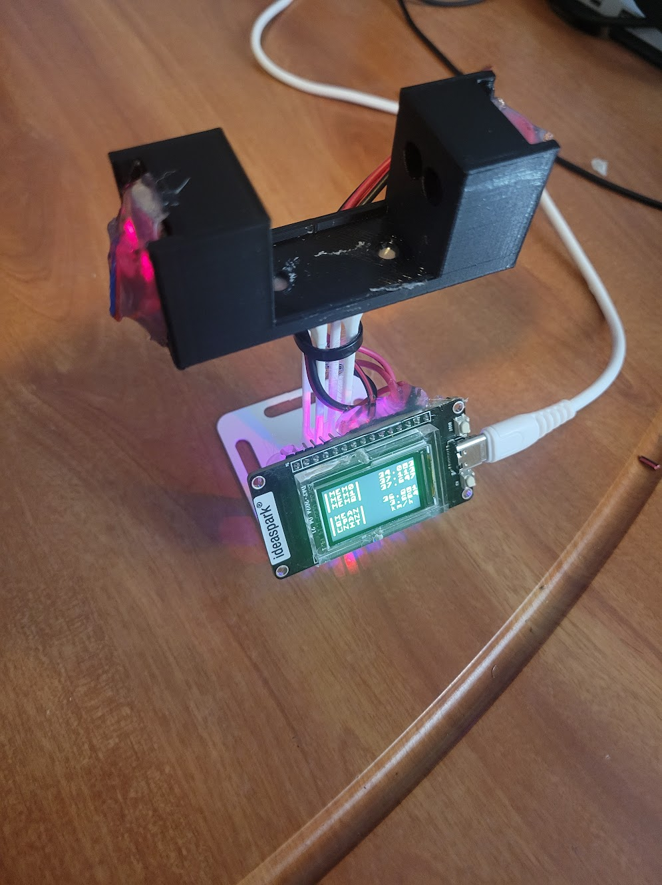

# Speed Trap

A handheld optical speed trap built around an ESP32 and written in `no_std` Rust. Two closely spaced
light beams sit inside a 3D-printed gate. When an object passes through, the firmware timestamps
the moment it interrupts each beam, divides the fixed beam spacing by the elapsed time, and shows
the speed on the board's built-in LCD.



## How it works

The gate holds two parallel beams 8 mm apart. Each beam falls on a phototransistor wired to a GPIO
pin with an internal pull-up. While the light reaches the transistor, it conducts and holds the pin
low. When an object blocks the beam, the transistor closes and the pin reads high.

The firmware polls both pins in a loop and runs a small state machine:

| State | What it waits for |
|---|---|
| `Idle` | Beam A to be blocked (starts the clock), or beam B to be blocked first (toggles the units) |
| `WaitForStopTrip` | Beam B to be blocked (stops the clock) |
| `WaitToPass` | Both beams to clear, so one pass is never counted twice |
| `Report` | Computes the speed, updates the three-reading memory, and redraws the screen |
| `WaitToggleUnit` | Both beams to clear after a unit toggle, then redraws with the new units |

Timestamps come from the ESP32 microsecond timer (`esp_hal::time::Instant`). The speed is
`separation_mm / elapsed_microseconds`, which is the same number as meters per second divided by
1000, then converted to the selected unit.

## Using it

1. Power the board over USB-C. A splash screen explains the controls.
2. Pass an object through the gate **from beam A to beam B** (the direction named on the splash
   screen). Its speed appears on the display.
3. Pass something through in the **reverse** direction, so beam B is blocked first, to cycle the
   units: m/s, km/h, ft/s, mph, and back to m/s. It starts in ft/s.

The display shows:

- `MEM0`, `MEM1`, `MEM2`: the last three readings, newest first
- `MEAN`: the average of those three readings
- `SPAN`: the largest difference between any two of them, a quick indication of how repeatable the
  measurements are
- `UNIT`: the current unit

## Hardware

| Part | Notes |
|---|---|
| ESP32 development board with a 1.14" ST7789 LCD | An ideaspark ESP32 board with an on-board 135 x 240 display |
| Two light emitters and two phototransistors | One pair per beam, mounted in the gate |
| 3D-printed gate | Holds the emitters on one side and the phototransistors on the other, 8 mm beam spacing |
| Bracket and wiring | Mounts the gate above the board |

Pin assignments (from `src/main_speed_trap.rs`):

| Function | GPIO |
|---|---|
| Beam A phototransistor input | 16 |
| Beam B phototransistor input | 5 |
| Display backlight | 32 |
| Display SPI MOSI | 23 |
| Display SPI SCLK | 18 |
| Display chip select | 15 |
| Display data/command | 2 |
| Display reset | 4 |

The beam spacing is set by `SEPARATION_MM` in `src/main_speed_trap.rs`. If you build a gate with a
different spacing, change that constant.

## Software layout

| File | Purpose |
|---|---|
| `src/bin/main.rs` | Entry point: initializes the ESP32 at maximum CPU clock and starts the speed trap |
| `src/main_speed_trap.rs` | Pin setup, display initialization, splash screen, and the main loop |
| `src/speed_trap.rs` | The state machine, speed math, unit conversion, three-reading memory, and results screen |
| `src/st7789_display_engine.rs` | ST7789 display driver: initialization, rotation, fills, triangles, and scalable text |
| `src/spi_master.rs` | Software (bit-banged) SPI master used to talk to the display |
| `src/font_64_bitmap_scalable.rs` | Bitmap font used for all on-screen text |
| `src/tb_st7789_display_engine.rs` | Display test bench, selectable from `main` in place of the speed trap |

`docs/` holds reference material used while writing the display driver, including the ST7789
datasheet and a write-up on the SPI protocol.

## Building and flashing

You need the Xtensa Rust toolchain for the ESP32 (the repo pins the `esp` channel in
`rust-toolchain.toml`) and `cargo-espflash`.

```sh
# one time: install the esp toolchain and flashing tool
cargo install espup cargo-espflash
espup install

# build, flash, and open the serial monitor
cargo espflash flash --monitor --chip esp32 --release
```

The build targets `xtensa-esp32-none-elf` with `build-std = ["core"]`, configured in
`.cargo/config.toml`. That file also sets `flash_board.ps1` as the cargo runner, so `cargo run`
works on Windows with PowerShell. On other systems, use the `cargo espflash` command above.

## Limitations

- Both beams are polled in a tight loop rather than read through interrupts, so timing resolution is
  limited by the loop speed and by how sharply the phototransistors switch.
- The speed is an average over an 8 mm span, not an instantaneous value.
- Objects must pass through in the intended direction to be timed. Passing in the opposite
  direction changes the units instead.
- Uses `esp-hal` 1.0.0-beta, whose API is not yet stable.
